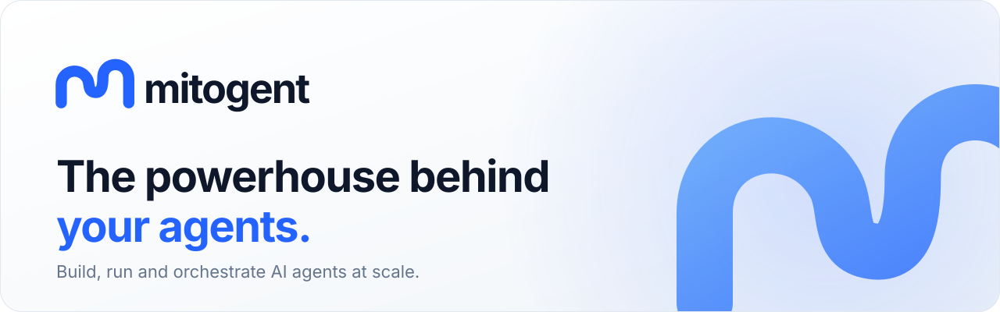

<picture>
  <source media="(prefers-color-scheme: dark)" srcset="./assets/banner-dark.svg">
  <source media="(prefers-color-scheme: light)" srcset="./assets/banner-light.svg">
  
</picture>

 
 

**Mitogent** provides the tools and infrastructure to build, run and orchestrate AI agents at scale.

### What we're building

| | |
| --- | --- |
| 🤖 **Agents** | Define agents that research, analyse, act and report. |
| 🔀 **Workflows** | Compose agents into multi-step pipelines with orchestration built in. |
| 🧰 **Tools** | Give agents safe, typed access to APIs, data and services. |
| 📚 **Knowledge** | Ground agents in your own documents and data sources. |
| 📊 **Evaluations** | Measure agent quality and catch regressions before they ship. |

### Principles

- **Developer first** — typed APIs, sensible defaults, no magic.
- **Production ready** — observable, testable and built to scale.

 

  <picture>
    <source media="(prefers-color-scheme: dark)" srcset="./assets/app-icon-dark.svg">
    
  </picture>

